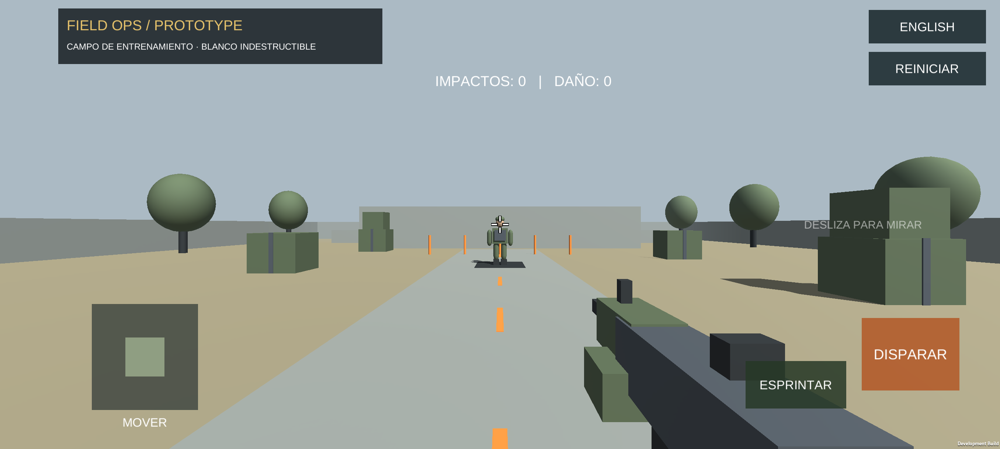

# Field Ops Prototype

**[English](#english) · [Español](#español)**

*EN: the phone screenshot is from the earlier free-practice delivery, before the timed-round, ammunition, aiming, settings and sound features. It does not show the current menus.*
*ES: la captura del teléfono es de la entrega anterior de práctica libre, antes de las partidas cronometradas, la munición, el apuntado, los ajustes y el sonido. No muestra los menús actuales.*

---

## English

A functional, small Android first-person shooter prototype for an academic demonstration, built with **Unity 6000.0.70f1**. Walk, look, sprint, aim and fire at an animated training target in a simplified semi-open military field. Choose a training round from **1 to 300 seconds**, earn one point per target hit, review the final score and play again. The interface supports English and Spanish.

This is an original training-range prototype, not an affiliated Call of Duty product. No Call of Duty assets, logos or copied game content are included.

### Open and play

1. Download or clone this repository into a local folder.
2. In Unity Hub, choose **Add > Add project from disk**, select that folder, and open it with **6000.0.70f1**. Install that editor's **Android Build Support**, including SDK, NDK and OpenJDK, through Hub if needed.
3. Wait for the first import, then open `Assets/FieldOps/Scenes/TrainingRange.unity`.
4. Press **Play**. Enter whole seconds (**1–300**, default **60**) and select **START ROUND / INICIAR PARTIDA**. In the active round, click the Game view to capture the mouse; press Escape to release it for the language and settings buttons.
5. At zero, firing and scoring stop. Read your score, then select **PLAY AGAIN / VOLVER A JUGAR** to replay the same duration, or **CHANGE DURATION / CAMBIAR DURACIÓN**.

The saved scene is editable: expand the field, target, player and HUD in the Hierarchy. Keep the editor version and pinned packages unchanged.

### Controls

| Action | Android | Editor |
|---|---|---|
| Move | Left joystick | WASD |
| Look | Swipe right side | Captured mouse |
| Sprint | Hold SPRINT / ESPRINTAR while moving | Hold left Shift |
| Fire | Hold FIRE / DISPARAR | Hold left mouse button |
| Reload | Tap RELOAD / RECARGAR (above the fire button) | R key |
| Aim down sights | Hold or tap AIM / APUNTAR (above sprint); mode set in settings | Right mouse button |
| Settings | SETTINGS / AJUSTES button, bottom-right | Escape, then click the button |
| Move the touch buttons | SETTINGS > EDIT LAYOUT / EDITAR BOTONES, then drag and SAVE / GUARDAR | Same, dragging with the mouse |
| Choose a weapon | `<` / `>` in the pre-round menu, on the results screen or in SETTINGS (swapping mid-round restarts the score) | Same |
| Switch language | ESPAÑOL / ENGLISH button | Escape, then click the button |
| Start / repeat a round | Enter seconds and tap the menu buttons | Enter seconds and click the menu buttons |

The visible countdown uses **MM:SS**. Empty, fractional, nonnumeric and out-of-range durations are rejected with a bilingual message, rather than silently clamped or shortened.

The target breathes and sways in place. Each hit adds 25 cumulative damage and a visible mark; it deliberately never dies. Damage is a practice counter, not a health bar. At most 60 marks are retained. English is the initial language, and the chosen language is stored locally. Separate fingers can operate movement, look, fire and sprint. Each successful target hit earns **1 point**; misses earn none. Starting or replaying a round clears points, damage, impact marks, ammunition and firing cooldown. There is no mid-round reset that can bypass the timer.

Configuration and results menus block movement, looking, firing and mouse capture. Held controls must be released and pressed again across a round transition. Losing app focus, going into the background or opening the settings menu pauses active-play time and clears held controls; resuming does not spend the paused interval.

### Build for Android

1. Unlock the phone, connect USB, enable USB debugging and accept the computer authorization prompt if requested.
2. In Unity, select **Field Ops > Build Android APK**. It creates a development APK at `Builds/FieldOpsPrototype.apk`: ARM64, IL2CPP, OpenGL ES 3 and landscape orientation.
3. Install that APK, or use Unity's Android build profile with this scene and **Build And Run** after selecting the phone.
4. On the phone, check numeric keyboard entry, invalid durations, a short round ending at zero, replay and change-duration, language switching, move/look/sprint/fire together, reload and ammunition, aiming in both modes, the settings menu, sound, and background/resume while holding controls.

The first import and IL2CPP build can take several minutes. A compiled APK exists locally for the demonstration; no GitHub release or APK download is provided by this source repository. Google Play publication and release signing are not included. Never commit signing keys or credentials.

### What is included

- First-person rifle, walking, looking, sprinting and touchscreen controls.
- Raycast firing, target damage counters and capped persistent impact marks.
- Animated idle target and original simplified training-field geometry.
- Configurable 1–300-second training rounds, countdown, hit score, results and replay.
- 30-round magazine with infinite reserve and manual reload (1.5 s, no auto-reload); ammo counter in the HUD. Ammo refills at every round start and reload time pauses with the round.
- Soldier target: the practice target is a low-poly tactical soldier (CC0 model by Quaternius, 3,106 triangles) that breathes with an idle animation and plays a short hit reaction when it is hit, then returns to idle. It is indestructible: it never dies or disappears. Hit zones cover the head, neck, torso, abdomen, hips, arms and legs, and the amber impact marks stay attached to the body while it moves. The model holds no weapon.
- Military training-base map: overcast open-field sky with a distant treeline, cracked asphalt firing lane, dry-dirt ground, shipping containers along both sides, sandbag walls, concrete barriers, a watchtower, an open hangar, oil drums, tires and supply crates. Everything is built from simple shapes with CC0 textures (Poly Haven), kept light for the phone, and the firing lane stays clear. It is an original base inspired by a military training ground, not a copy of any commercial game's map.
- On-screen FPS counter (top center, green from 50 FPS, yellow from 30, red below). It is on by default; the settings menu has a switch to hide or show it, and the choice is stored locally. In development builds the game also logs frame-time statistics every 10 seconds for `adb logcat`.
- Five selectable weapons with generic names: pistol, assault rifle, sub-machine gun, shotgun and sniper rifle. Each has its own magazine size, fire rate, damage, range, recoil and aiming zoom (the shotgun fires 8 pellets and scores one point per shot that hits). The choice is stored locally and can be changed in the pre-round menu, on the results screen and in the settings menu; swapping during a round restarts the score and target counters, gives a full magazine and keeps the clock. Models are low-poly CC0 assets (see [CREDITS.md](CREDITS.md)).
- Configurable HUD: from the settings menu, drag the joystick and the fire, reload, aim and sprint buttons anywhere on screen. The layout is stored locally and restored on the next launch. Buttons stay inside the screen, saving is refused while buttons overlap each other or the settings and language buttons, and RESET / CANCEL are available. The round is paused while editing.
- Aim down sights (ADS): 40-degree zoom with smooth transition, half look sensitivity, red-dot sight and a lowered rifle. A settings menu (it pauses the round) chooses hold or toggle mode and whether the cross reticle stays visible while aiming; both choices are stored locally. Sprinting cancels aiming; reloading does not.
- Per-weapon sound effects: every weapon has its own recorded shot and reload sound (processed single shots and reloads from CC BY 3.0 and CC0 recordings, credited in [CREDITS.md](CREDITS.md)), and a reload lasts as long as its sound. The empty-magazine click and the target-hit sound are generated by code. Sounds stop when a round is paused or ends, swapping weapons cuts the previous sound, and menus are silent.
- English and Spanish buttons and messages.

**Out of scope for this delivery:** music, footsteps and menu sounds, attacking enemies, death, multiplayer, campaign missions and production-quality animation.

### Verification

Current source checks passed: **185/185 EditMode** and **54/54 PlayMode** tests. These include soldier-target, scenery, sky and FPS-counter checks, weapon audio, stats, selection and model-orientation checks, HUD layout rules and the layout editor, sound synthesis and playback rules, aim and settings rules, magazine and reload rules, duration boundaries, countdown and score rules, queued touch interactions with the actual menu and input field, expiry and replay, held-input suppression and pause/focus behavior. Configuration, active-play, aiming and settings views were rendered and visually checked in the editor.

The timed-round, ammo/reload, ADS/settings, sound, configurable-HUD, five-weapon, per-weapon-audio, military-base-map, FPS-counter and soldier-target builds were installed and manually tested on a Motorola edge 60 fusion running Android 16; the user reported that keyboard entry, validation, countdown, results, replay, language, background/resume, reload, aiming, settings, sound, layout-editor, weapon-selection, weapon-model, weapon-sound, map, FPS-counter and soldier-target checks all passed.

No FPS, thermal or long-session endurance benchmark is claimed. See [VERIFICATION.md](VERIFICATION.md) (in English) for evidence and reproduction commands.

### Project layout and editing

| Path | Purpose |
|---|---|
| `Assets/FieldOps/Scenes` | Editable training scene |
| `Assets/FieldOps/Scripts` | Movement, input, weapons, ammunition, aiming, sound, target, round rules, settings and HUD |
| `Assets/FieldOps/Weapons` | Generated weapon definitions (stats and model per weapon) |
| `Assets/FieldOps/ThirdParty` | Third-party assets with their notices (see [CREDITS.md](CREDITS.md)) |
| `Assets/FieldOps/Audio` | Processed weapon sound effects with their notice (see [CREDITS.md](CREDITS.md)) |
| `Assets/FieldOps/Animation` | Generated animator controller for the soldier target |
| `Assets/FieldOps/Editor` | Scene generation, Android build and UI build validation |
| `Assets/FieldOps/Tests` | EditMode and PlayMode tests |
| `Packages` | Pinned manifest and dependency lockfile |
| `ProjectSettings` | Portable Unity project configuration |
| `docs/images` | Android demonstration capture (earlier delivery) |

**Field Ops > Create or Rebuild Training Range** replaces the generated scene and materials. Save custom scene variants under another name first. Run tests through **Window > General > Test Runner** in the EditMode and PlayMode tabs. The project uses Unity's built-in render pipeline.

Source includes Unity `.meta` files to preserve asset references. `.gitignore` excludes caches, local settings, logs, builds, IDE files and credentials. Do not upload those files when extending the project.

### Licensing

Original project code and original generated art use the included [MIT license](LICENSE). Preserve its copyright and license notice when redistributing source; no in-game attribution screen is required by that license. The weapon models are third-party CC0 assets listed in [CREDITS.md](CREDITS.md); weapon names in the game are generic and no Call of Duty content is used. The weapon shot sounds are CC BY 3.0 (credit: Vincent Sevedge) and the reload sounds are CC0; credits and the changes made are in [CREDITS.md](CREDITS.md) and the notice next to the audio files. The environment textures and the sky are CC0 (Poly Haven), and the soldier model is CC0 (Quaternius); both are credited there.

Unity engine/editor and Unity packages have their own terms and licenses. This project does not replace those terms or promise legal clearance for future resources. Check both use and source-redistribution permissions before adding assets to a public repository.

[Back to top](#field-ops-prototype)

---

## Español

Prototipo funcional y pequeño de un juego de disparos en primera persona para Android, hecho para una demostración académica con **Unity 6000.0.70f1**. Camina, mira, corre, apunta y dispara a un blanco de entrenamiento animado en un campo militar semiabierto y simplificado. Elige una partida de entrenamiento de **1 a 300 segundos**, gana un punto por cada impacto en el blanco, revisa tu puntaje final y vuelve a jugar. La interfaz está en inglés y en español.

Es un prototipo original de campo de entrenamiento y no es un producto afiliado a Call of Duty. No incluye recursos, logotipos ni contenido copiado de Call of Duty.

### Abrir y jugar

1. Descarga o clona este repositorio en una carpeta local.
2. En Unity Hub, elige **Add > Add project from disk**, selecciona esa carpeta y ábrela con **6000.0.70f1**. Si hace falta, instala desde Hub el **Android Build Support** de ese editor, con SDK, NDK y OpenJDK.
3. Espera la primera importación y abre `Assets/FieldOps/Scenes/TrainingRange.unity`.
4. Pulsa **Play**. Escribe los segundos en números enteros (**1–300**, por defecto **60**) y elige **START ROUND / INICIAR PARTIDA**. Durante la partida, haz clic en la vista Game para capturar el ratón; pulsa Escape para liberarlo y usar los botones de idioma y ajustes.
5. Al llegar a cero, se detienen los disparos y el puntaje. Lee tu puntaje y elige **PLAY AGAIN / VOLVER A JUGAR** para repetir la misma duración, o **CHANGE DURATION / CAMBIAR DURACIÓN**.

La escena guardada es editable: expande el campo, el blanco, el jugador y la interfaz en la Hierarchy. Mantén sin cambios la versión del editor y los paquetes fijados.

### Controles

| Acción | Android | Editor |
|---|---|---|
| Moverse | Joystick izquierdo | WASD |
| Mirar | Deslizar el lado derecho | Ratón capturado |
| Correr | Mantener SPRINT / ESPRINTAR mientras te mueves | Mantener Shift izquierdo |
| Disparar | Mantener FIRE / DISPARAR | Mantener el botón izquierdo del ratón |
| Recargar | Tocar RELOAD / RECARGAR (encima del botón de disparo) | Tecla R |
| Apuntar (ADS) | Mantener o tocar AIM / APUNTAR (encima de correr); el modo se elige en ajustes | Botón derecho del ratón |
| Ajustes | Botón SETTINGS / AJUSTES, abajo a la derecha | Escape y luego clic en el botón |
| Mover los botones táctiles | SETTINGS / AJUSTES > EDIT LAYOUT / EDITAR BOTONES, arrastrar y GUARDAR | Igual, arrastrando con el ratón |
| Elegir arma | `<` / `>` en el menú previo, en la pantalla de resultados o en AJUSTES (cambiar a mitad de partida reinicia el puntaje) | Igual |
| Cambiar idioma | Botón ESPAÑOL / ENGLISH | Escape y luego clic en el botón |
| Iniciar o repetir una partida | Escribir los segundos y tocar los botones del menú | Escribir los segundos y hacer clic en los botones del menú |

La cuenta regresiva visible usa el formato **MM:SS**. Las duraciones vacías, con decimales, no numéricas o fuera de rango se rechazan con un mensaje bilingüe, en lugar de ajustarse o recortarse en silencio.

El blanco respira y se balancea en su sitio. Cada impacto suma 25 de daño acumulado y deja una marca visible; a propósito, nunca muere. El daño es un contador de práctica, no una barra de vida. Se conservan como máximo 60 marcas. El idioma inicial es el inglés y el idioma elegido se guarda localmente. Distintos dedos pueden manejar a la vez el movimiento, la mirada, el disparo y la carrera. Cada impacto exitoso en el blanco da **1 punto**; los disparos fallidos no dan nada. Al iniciar o repetir una partida se reinician los puntos, el daño, las marcas de impacto, la munición y el tiempo de espera entre disparos. No hay un reinicio a mitad de partida que permita saltarse el cronómetro.

Los menús de configuración y de resultados bloquean el movimiento, la mirada, el disparo y la captura del ratón. Los controles mantenidos deben soltarse y volver a pulsarse al cambiar de fase. Perder el foco de la aplicación, enviarla a segundo plano o abrir el menú de ajustes pausa el tiempo de juego activo y suelta los controles mantenidos; al volver, no se gasta el tiempo en pausa.

### Compilar para Android

1. Desbloquea el teléfono, conéctalo por USB, activa la depuración USB y acepta la autorización del computador si se solicita.
2. En Unity, elige **Field Ops > Build Android APK**. Se crea un APK de desarrollo en `Builds/FieldOpsPrototype.apk`: ARM64, IL2CPP, OpenGL ES 3 y orientación horizontal.
3. Instala ese APK, o usa el perfil de compilación de Android de Unity con esta escena y **Build And Run** tras seleccionar el teléfono.
4. En el teléfono, comprueba el teclado numérico, las duraciones inválidas, una partida corta que termina en cero, repetir y cambiar la duración, el cambio de idioma, mover, mirar, correr y disparar a la vez, la recarga y la munición, apuntar en los dos modos, el menú de ajustes, el sonido, y pasar a segundo plano y volver mientras se mantienen controles.

La primera importación y la compilación con IL2CPP pueden tardar varios minutos. Existe un APK compilado de forma local para la demostración; este repositorio de código fuente no ofrece una publicación (release) de GitHub ni una descarga del APK. No se incluyen la publicación en Google Play ni la firma de producción. Nunca subas claves de firma ni credenciales al repositorio.

### Qué incluye

- Rifle en primera persona, caminar, mirar, correr y controles táctiles.
- Disparo por raycast, contadores de daño del blanco y marcas de impacto persistentes con límite.
- Blanco animado en reposo y geometría original y simplificada del campo de entrenamiento.
- Partidas de entrenamiento configurables de 1 a 300 segundos, con cuenta regresiva, puntaje por impactos, resultados y repetición.
- Cargador de 30 balas con reserva infinita y recarga manual (1,5 s, sin recarga automática); contador de munición en pantalla. La munición se restablece al iniciar cada partida y el tiempo de recarga se pausa junto con la partida.
- Blanco soldado: el blanco de práctica es un soldado táctico de pocos polígonos (modelo CC0 de Quaternius, 3.106 triángulos) que respira con una animación de reposo y hace una breve reacción cuando recibe un impacto, y luego vuelve a reposo. Es indestructible: nunca muere ni desaparece. Las zonas de impacto cubren cabeza, cuello, torso, abdomen, cadera, brazos y piernas, y las marcas de impacto ámbar se quedan pegadas al cuerpo mientras se mueve. El modelo no sostiene ningún arma.
- Mapa de base militar de entrenamiento: cielo nublado de campo abierto con una línea de árboles al fondo, carril de tiro de asfalto agrietado, suelo de tierra seca, contenedores a ambos lados, muros de sacos de arena, barreras de concreto, una torre de vigilancia, un hangar abierto, barriles, neumáticos y cajas de suministros. Todo está hecho con formas simples y texturas CC0 (Poly Haven), liviano para el teléfono, y el carril de tiro queda despejado. Es una base original inspirada en un campo de entrenamiento militar, no una copia del mapa de ningún juego comercial.
- Contador de FPS en pantalla (arriba al centro; verde desde 50 FPS, amarillo desde 30 y rojo por debajo). Viene activo por defecto; el menú de ajustes tiene un interruptor para ocultarlo o mostrarlo y la elección se guarda localmente. En las compilaciones de desarrollo el juego también registra estadísticas de tiempo de cuadro cada 10 segundos para `adb logcat`.
- Cinco armas seleccionables con nombres genéricos: pistola, fusil de asalto, subfusil, escopeta y francotirador. Cada una tiene su propio tamaño de cargador, cadencia, daño, alcance, retroceso y zoom al apuntar (la escopeta dispara 8 perdigones y da un punto por disparo que acierta). La elección se guarda localmente y se puede cambiar en el menú previo, en la pantalla de resultados y en el menú de ajustes; cambiar a mitad de partida reinicia el puntaje y los contadores del blanco, da un cargador lleno y conserva el cronómetro. Los modelos son recursos CC0 de pocos polígonos (ver [CREDITS.md](CREDITS.md)).
- Interfaz configurable: desde el menú de ajustes, arrastra el joystick y los botones de disparar, recargar, apuntar y correr a cualquier lugar de la pantalla. El diseño se guarda localmente y se restaura al abrir la aplicación. Los botones no salen de la pantalla, no se puede guardar mientras se superpongan entre sí o con los botones de ajustes e idioma, y hay opciones para restablecer y cancelar. La partida se pausa mientras editas.
- Apuntar con mira (ADS): zoom de 40 grados con transición suave, mitad de sensibilidad al mirar, mira de punto rojo y rifle bajado. Un menú de ajustes (que pausa la partida) permite elegir el modo mantener o alternar y si la mira de cruz sigue visible al apuntar; ambas opciones se guardan localmente. Correr cancela el apuntado; recargar no.
- Efectos de sonido por arma: cada arma tiene su propio sonido grabado de disparo y de recarga (disparos y recargas sueltos procesados a partir de grabaciones CC BY 3.0 y CC0, acreditados en [CREDITS.md](CREDITS.md)), y la recarga dura lo mismo que su sonido. El clic de cargador vacío y el sonido de impacto en el blanco se generan por código. Los sonidos se cortan al pausar o terminar una partida, cambiar de arma corta el sonido anterior, y los menús son silenciosos.
- Botones y mensajes en inglés y en español.

**Fuera del alcance de esta entrega:** música, pasos y sonidos de menú, enemigos que atacan, muerte, multijugador, misiones de campaña y animación de calidad de producción.

### Verificación

Las comprobaciones actuales del código fuente pasaron: **185/185 pruebas EditMode** y **54/54 pruebas PlayMode**. Incluyen las comprobaciones del soldado, el escenario, el cielo y el contador de FPS, las de armas (audio, estadísticas, selección y orientación de los modelos), las reglas de diseño de la interfaz y su editor, las reglas de síntesis y reproducción de sonido, de apuntado y ajustes, de cargador y recarga, los límites de duración, la cuenta regresiva y el puntaje, toques en cola sobre el menú y el campo de texto reales, expiración y repetición, supresión de controles mantenidos y comportamiento de pausa y foco. Las vistas de configuración, juego activo, apuntado y ajustes se renderizaron y se revisaron visualmente en el editor.

Las compilaciones de partidas cronometradas, munición y recarga, ADS y ajustes, sonido, interfaz configurable, cinco armas, audio por arma, mapa de base militar, contador de FPS y soldado se instalaron y se probaron manualmente en un Motorola edge 60 fusion con Android 16; el usuario reportó que pasaron todas las comprobaciones de teclado, validación, cuenta regresiva, resultados, repetición, idioma, segundo plano y regreso, recarga, apuntado, ajustes, sonido, editor de diseño, selección de arma, modelos de armas, sonido por arma, mapa, contador de FPS y soldado.

No se afirma ninguna medición de FPS, temperatura ni resistencia en sesiones largas. Consulta [VERIFICATION.md](VERIFICATION.md) (en inglés) para ver la evidencia y los comandos de reproducción.

### Estructura del proyecto y edición

| Ruta | Propósito |
|---|---|
| `Assets/FieldOps/Scenes` | Escena de entrenamiento editable |
| `Assets/FieldOps/Scripts` | Movimiento, entrada, armas, munición, apuntado, sonido, blanco, reglas de partida, ajustes e interfaz |
| `Assets/FieldOps/Weapons` | Definiciones de armas generadas (estadísticas y modelo de cada una) |
| `Assets/FieldOps/ThirdParty` | Recursos de terceros con sus avisos (ver [CREDITS.md](CREDITS.md)) |
| `Assets/FieldOps/Audio` | Efectos de sonido de armas procesados, con su aviso (ver [CREDITS.md](CREDITS.md)) |
| `Assets/FieldOps/Animation` | Controlador de animación generado para el blanco soldado |
| `Assets/FieldOps/Editor` | Generación de la escena, compilación para Android y validación de la interfaz |
| `Assets/FieldOps/Tests` | Pruebas EditMode y PlayMode |
| `Packages` | Manifiesto fijado y archivo de bloqueo de dependencias |
| `ProjectSettings` | Configuración portátil del proyecto de Unity |
| `docs/images` | Captura de demostración en Android (entrega anterior) |

**Field Ops > Create or Rebuild Training Range** reemplaza la escena y los materiales generados. Guarda antes con otro nombre las variantes personalizadas de la escena. Ejecuta las pruebas desde **Window > General > Test Runner**, en las pestañas EditMode y PlayMode. El proyecto usa el pipeline de renderizado integrado de Unity.

El código fuente incluye los archivos `.meta` de Unity para conservar las referencias entre recursos. `.gitignore` excluye cachés, configuración local, registros, compilaciones, archivos de IDE y credenciales. No subas esos archivos al ampliar el proyecto.

### Licencias

El código original del proyecto y el arte original generado usan la [licencia MIT](LICENSE) incluida (el texto de la licencia está en inglés). Conserva su aviso de derechos de autor y de licencia al redistribuir el código; esa licencia no exige una pantalla de créditos dentro del juego. Los modelos de armas son recursos CC0 de terceros listados en [CREDITS.md](CREDITS.md); los nombres de las armas dentro del juego son genéricos y no se usa contenido de Call of Duty. Los sonidos de disparo de las armas son CC BY 3.0 (crédito: Vincent Sevedge) y los de recarga son CC0; los créditos y los cambios realizados están en [CREDITS.md](CREDITS.md) y en el aviso junto a los archivos de audio. Las texturas del entorno y el cielo son CC0 (Poly Haven) y el modelo del soldado es CC0 (Quaternius); ambos están acreditados allí.

El motor y el editor de Unity y sus paquetes tienen sus propios términos y licencias. Este proyecto no los reemplaza ni promete autorización legal para recursos futuros. Antes de agregar recursos a un repositorio público, verifica tanto el permiso de uso como el de redistribución del código fuente.

[Volver arriba](#field-ops-prototype)
